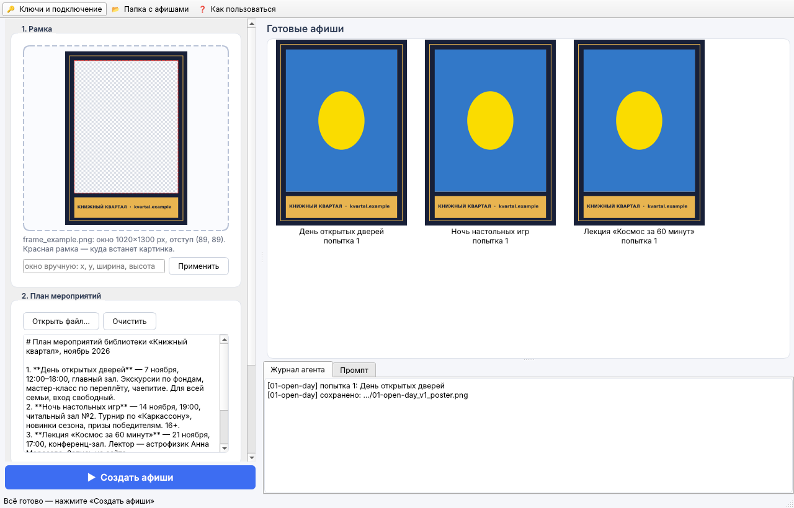

# Агент для афиш по плану мероприятий

ИИ-агент делает готовые афиши по плану мероприятий:

1. **Claude** читает план (текст, таблицу, PDF, DOCX, XLSX) и рамку пользователя. Для каждого
   мероприятия он пишет подробный промпт с учётом стиля и палитры рамки и формы окна.
2. Через инструмент `create_poster` промпт уходит в **air.fail → gptimage**
   (`https://api.air.fail/public/image/gptimage`). Это тот же GPT Image, что на
   https://app.air.fail/images/gptimage, только через API-ключ.
3. Картинка масштабируется с обрезкой под окно рамки, рамка кладётся поверх.
4. Готовая афиша возвращается Claude на проверку. Если текст искажён, главный объект
   обрезан или стиль не подходит к рамке, агент исправляет промпт и генерирует заново
   (не больше 3 попыток на мероприятие).

## Рамка

Подойдёт PNG, где область под картинку:
- **прозрачная** (лучший вариант, окно находится автоматически), или
- залита **чистым зелёным `#00FF00`** (хромакей), или
- задана вручную: `--box x,y,w,h`.

Под пропорции окна выбирается ближайший размер генерации: 1024×1024, 1024×1536 или 1536×1024.
Пример рамки лежит в `examples/frame_example.png`, а создаёт её `examples/make_example_frame.py`.

## Быстрый старт (Windows, без Python)

1. Скачайте **PosterAgent.zip** (или PosterAgent.exe) из релиза
   [poster-agent-latest](https://github.com/FXcoder212/oreshkin_i_v/releases/tag/poster-agent-latest).
   Он же лежит в артефактах сборки *poster-agent exe* на вкладке Actions.
2. Запустите двойным кликом. Windows может показать «Windows защитила ваш компьютер»,
   потому что exe не подписан. Тогда нажмите «Подробнее» → «Выполнить в любом случае».
3. Нажмите **«Ключи и подключение»** и введите ключ Claude и ключ air.fail. Это нужно один раз:
   ключи сохраняются в `%APPDATA%\PosterAgent\settings.json`.
4. Перетащите рамку и вставьте план (или откройте файл Word/Excel/PDF/текст).
   Нажмите **«Создать афиши»**.



Как устроено окно:
- **Рамка.** Окно, куда встанет картинка, обводится красным пунктиром. Если окно
  определилось неверно, его можно задать вручную.
- **План.** Текст редактируется прямо в окне. PDF и картинки передаются агенту целиком.
- **Параметры.** Можно включить или выключить надписи на картинке, выбрать режим
  «только промпты», тщательность агента и папку для результатов. Каждый запуск
  сохраняется в отдельную подпапку с датой.
- **Готовые афиши.** Афиши появляются по мере готовности, в том числе повторные попытки.
  Клик показывает промпт, двойной клик открывает файл.
- **«Остановить»** прерывает работу после текущего шага. Уже готовые афиши сохраняются.

## Запуск из исходников

- **Windows:** дважды кликните `Запуск.bat`. При первом запуске он сам создаст окружение
  и поставит зависимости. Нужен установленный Python 3.10+.
- **Linux/macOS:** `./run.sh`.
- **Вручную:** `pip install -r requirements.txt`, затем `python -m poster_agent`.

Без аргументов открывается окно. С аргументами программа работает как командная строка
(ключи берутся из `ANTHROPIC_API_KEY` и `AIRFAIL_API_KEY`):

```bash
python -m poster_agent --plan examples/plan_example.md --frame examples/frame_example.png --out posters
```

Флаги:
- `--no-text` — без надписей;
- `--dry-run` — только промпты;
- `--effort low|medium|high|xhigh|max` — тщательность агента;
- `--box x,y,w,h` — окно вручную.

Есть и веб-версия: `pip install -r requirements-web.txt && streamlit run app.py`.

## Сборка exe

- **Автоматически.** Каждый push в `poster_agent/` запускает GitHub Actions
  (`.github/workflows/poster-agent-exe.yml`). Сборка идёт на Windows через PyInstaller,
  exe проходит проверку запуска и публикуется в релиз `poster-agent-latest`.
- **Локально на Windows:** дважды кликните `Собрать exe.bat`. Результат появится в `dist\PosterAgent.exe`.

## Что получается

В папке `--out` для каждой попытки лежат три файла и общий манифест:
- `<id>_vN_prompt.txt` — промпт;
- `<id>_vN_art.png` — исходная картинка;
- `<id>_vN_poster.png` — афиша в рамке;
- `manifest.json` — все мероприятия, промпты, попытки и ошибки.

## Настройка air.fail

Открытой документации по image-эндпоинту у air.fail нет. Клиент повторяет схему их
публичного API (`api.air.fail/public/openapi.json`): тело `{"content": <промпт>, "info": {...}}`,
ключ передаётся в заголовке `Authorization`. В ответе клиент сам ищет ссылку на картинку
или base64. Если у вашего аккаунта формат другой, его можно поменять в окне «Ключи и подключение» или переменными окружения:

| Переменная | По умолчанию | Назначение |
|---|---|---|
| `AIRFAIL_ENDPOINT` | `https://api.air.fail/public/image/gptimage` | адрес генерации |
| `AIRFAIL_AUTH_SCHEME` | пусто (`Authorization: <ключ>`) | `Bearer`, если нужен `Authorization: Bearer <ключ>` |
| `AIRFAIL_INFO_JSON` | — | доп. параметры в `info`, например `{"quality": "high"}` |

## Устройство

- `poster_agent/agent.py` — агент: системный промпт, инструмент `create_poster`, цикл
  `client.beta.messages.tool_runner` (Claude Opus 5.5, адаптивное мышление, серверный fallback).
- `poster_agent/airfail.py` — клиент air.fail.
- `poster_agent/frame.py` — поиск окна в рамке и композиция.
- `poster_agent/gui.py` — оконный интерфейс (PySide6), `poster_agent/config.py` — хранение настроек.
- `poster_agent/cli.py` — командная строка.
- `packaging/` — точка входа и spec для PyInstaller, генератор иконки.
- `app.py` — веб-интерфейс на Streamlit.
